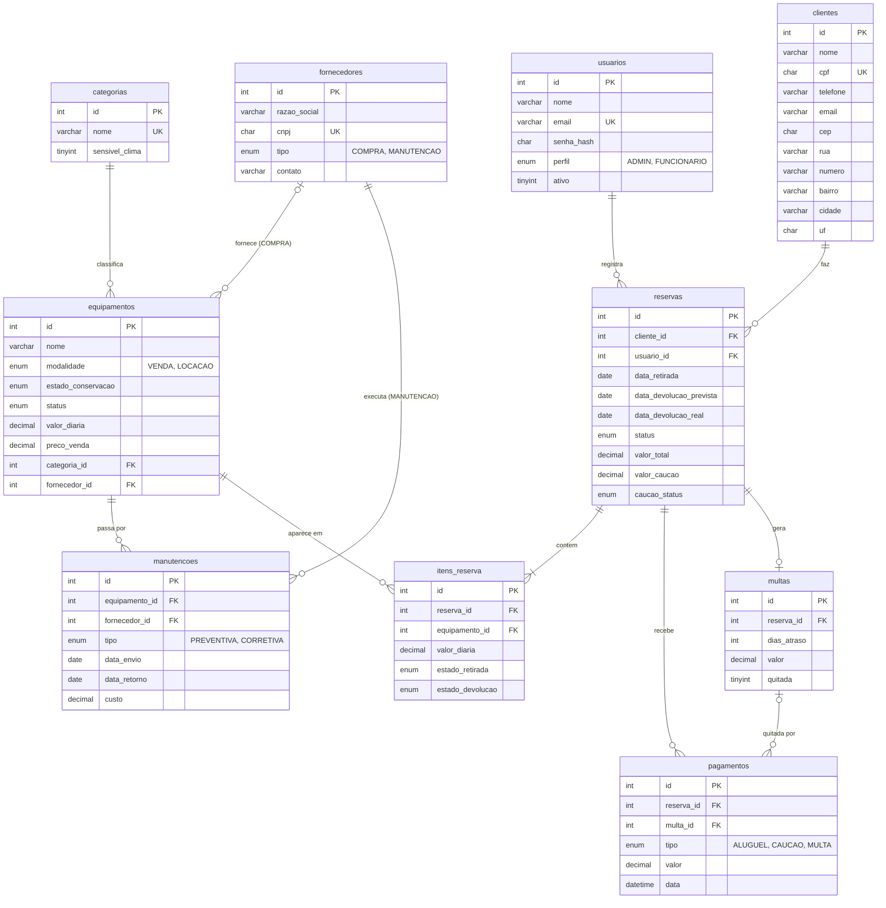

# Proposta de Arquitetura e Banco de Dados — Passo 0

**Projeto:** Sistema de Gestão & Aluguel de Equipamentos Esportivos
**Disciplina:** DAD — Desenvolvimento de Aplicações Desktop (Electron + TypeScript)
**Status:** proposta para discussão na reunião do grupo (nada aqui está implementado ainda)

---

## 1. Resumo das decisões

### 1.1 Stack

| Camada | Escolha | Por quê |
|---|---|---|
| Linguagem | TypeScript em tudo (`strict: true`) | Requisito 6 do professor: nenhum `.js` de lógica da aplicação |
| Desktop | Electron (Main + Preload + Renderer) | Requisito 6 |
| Banco | **MySQL 8** | Ver 1.2 |
| Driver | `mysql2/promise` com **pool** de conexões | Suporte a Promise/async, pool, transações e **queries parametrizadas** (`?`) |
| Arquitetura | Camadas: Renderer → preload (contextBridge) → `ipcMain.handle` → Service → Repository → MySQL | Separação de responsabilidades, POO (Requisito 5), segurança |

### 1.2 Por que MySQL (e não SQLite)

- **O PDF do professor (`requisitos-projeto-final.pdf`) diz apenas "Banco de dados relacional com no mínimo 6 tabelas relacionadas entre si"** — não exige SQLite nem nenhum SGBD específico. Conferido no item 1 dos "Requisitos técnicos obrigatórios".
- A divisão de tarefas sugeria SQLite só como opção "mais simples"; o grupo decidiu por MySQL.
- Justificativas para apresentar ao professor:

| Motivo | Detalhe |
|---|---|
| FKs sempre ativas | No InnoDB as chaves estrangeiras são verificadas por padrão (no SQLite é preciso `PRAGMA foreign_keys = ON` em toda conexão) |
| Tipos fortes | `ENUM`, `DECIMAL(10,2)` para dinheiro, `DATE`/`DATETIME` reais, `CHECK` (MySQL 8.0.16+) |
| Transações e concorrência | InnoDB com transações ACID e bloqueio por linha (importante para criar reserva com vários itens) |
| Ferramentas | MySQL Workbench para visualizar o ER e depurar dados |
| Familiaridade do grupo | SGBD já usado em outras disciplinas |
| Segurança | Usuário de banco próprio com privilégios mínimos (só `SELECT/INSERT/UPDATE/DELETE`) |

- **Custo da decisão (registrar no README):** cada integrante precisa de um **servidor MySQL local** (MySQL 8 instalado, XAMPP/MariaDB compatível ou Docker `mysql:8`). O instalador do app não leva o banco junto.
- **Credenciais em `.env`** (fora do Git), com `.env.example` versionado:

```env
DB_HOST=localhost
DB_PORT=3306
DB_USER=app_aluguel
DB_PASSWORD=troque_aqui
DB_NAME=aluguel_esportivo
DB_POOL_LIMIT=10
```

### 1.3 Bibliotecas sugeridas

| Biblioteca | Uso | Quem usa mais |
|---|---|---|
| `electron`, `electron-vite` (ou Electron Forge) | Base do projeto e build TS | Pessoa 1 |
| `typescript` | Linguagem | Todos |
| `mysql2` | Driver MySQL com pool e queries parametrizadas | Pessoa 1 |
| `dotenv` | Ler `.env` no Main Process | Pessoa 1 e 3 |
| `bcryptjs` (ou `bcrypt`) | Hash de senha. `bcryptjs` evita recompilar módulo nativo para o Electron | Pessoa 3 |
| `zod` | Validação dos DTOs recebidos via IPC | Pessoa 3 (todos usam) |
| `vitest` | Testes unitários | Todos |
| `eslint` + `prettier` | Padrão de código | Todos |
| `electron-builder` | Instalador | Pessoa 4 |
| `express` | API própria de notificações | Pessoa 1 |

---

## 2. Visão geral dos relacionamentos

### 2.1 Como ler a notação

| Notação | Significado | Exemplo |
|---|---|---|
| `dona (filhas)` | Ligação de **um só sentido (1:N)**. A tabela fora dos parênteses é a "dona"; as tabelas entre parênteses têm a FK que aponta para ela | `clientes (reservas)` = um cliente tem várias reservas; a FK `cliente_id` fica em `reservas` |
| `A <-> B (via C)` | Ligação nos **dois sentidos (N:N)**, através de uma tabela intermediária C que tem FK para A e para B | `reservas <-> equipamentos (via itens_reserva)` = uma reserva tem vários equipamentos e um equipamento aparece em várias reservas |
| `—` | A tabela não é dona de ninguém (só tem FKs apontando para fora) | — |

### 2.2 Lista completa (10 tabelas)

**Ligações 1:N (um sentido)**

1. `usuarios (reservas)` — um usuário (funcionário/admin) registra várias reservas.
2. `clientes (reservas)` — um cliente tem várias reservas.
3. `categorias (equipamentos)` — uma categoria agrupa vários equipamentos.
4. `fornecedores (equipamentos, manutencoes)` — um fornecedor de COMPRA fornece vários equipamentos; um prestador de MANUTENCAO executa várias manutenções.
5. `equipamentos (itens_reserva, manutencoes)` — um equipamento aparece em vários itens de reserva e tem várias manutenções.
6. `reservas (itens_reserva, pagamentos, multas)` — uma reserva tem vários itens, vários pagamentos e (no máximo) uma multa de atraso.
7. `multas (pagamentos)` — uma multa pode ser quitada por um ou mais pagamentos do tipo MULTA.
8. `itens_reserva` — — (só aponta para `reservas` e `equipamentos`).
9. `manutencoes` — — (só aponta para `equipamentos` e `fornecedores`).
10. `pagamentos` — — (só aponta para `reservas` e `multas`).

**Ligações N:N (dois sentidos)**

- `reservas <-> equipamentos (via itens_reserva)`
- `equipamentos <-> fornecedores (via manutencoes)` — um equipamento pode ir a vários prestadores e um prestador conserta vários equipamentos (apenas fornecedores tipo MANUTENCAO).

**Conferência:** nenhuma tabela está solta. Total de **11 chaves estrangeiras** reais.

---

## 3. As 10 tabelas

> Convenções: nomes em `snake_case`, PK `id INT UNSIGNED AUTO_INCREMENT`, dinheiro em `DECIMAL(10,2)`, todas com `created_at` e `updated_at`. Todas as FKs usam `ON UPDATE CASCADE` (ids não mudam, é só por coerência).

### 3.1 `usuarios`

Quem acessa o sistema (login) e com qual perfil.

| Campo | Tipo MySQL | Obrigatório | Chave | Descrição |
|---|---|---|---|---|
| id | INT UNSIGNED AUTO_INCREMENT | Sim | PK | Identificador |
| nome | VARCHAR(100) | Sim | | Nome do usuário |
| email | VARCHAR(150) | Sim | UNIQUE | Login |
| senha_hash | CHAR(60) | Sim | | Hash bcrypt (nunca a senha pura) |
| perfil | ENUM('ADMIN','FUNCIONARIO') | Sim | | Controle de acesso; padrão FUNCIONARIO |
| ativo | TINYINT(1) | Sim | | 1 = pode logar; desativar em vez de excluir quem já tem reservas |
| ultimo_login | DATETIME | Não | | Auditoria simples |
| created_at | DATETIME | Sim | | Criação (DEFAULT CURRENT_TIMESTAMP) |
| updated_at | DATETIME | Sim | | Última alteração (ON UPDATE CURRENT_TIMESTAMP) |

**Ligações:** `usuarios (reservas)`. Não tem FK própria. `reservas.usuario_id → usuarios.id` com **ON DELETE RESTRICT**: não se apaga quem registrou reservas (auditoria); o caminho é `ativo = 0`.

### 3.2 `clientes`

Clientes que alugam ou compram; endereço preenchido pelo ViaCEP.

| Campo | Tipo MySQL | Obrigatório | Chave | Descrição |
|---|---|---|---|---|
| id | INT UNSIGNED AUTO_INCREMENT | Sim | PK | Identificador |
| nome | VARCHAR(120) | Sim | | Nome completo |
| cpf | CHAR(11) | Sim | UNIQUE | Só dígitos; validado (dígito verificador) e mascarado na UI (LGPD) |
| telefone | VARCHAR(20) | Sim | | Contato / lembrete |
| email | VARCHAR(150) | Não | | Para notificações |
| cep | CHAR(8) | Sim | | Só dígitos; dispara `integracoes:buscarCep` |
| rua | VARCHAR(150) | Sim | | Preenchido pelo ViaCEP (editável) |
| numero | VARCHAR(10) | Sim | | Digitado |
| complemento | VARCHAR(60) | Não | | Digitado |
| bairro | VARCHAR(80) | Sim | | ViaCEP |
| cidade | VARCHAR(80) | Sim | | ViaCEP; também usada no clima e na rota |
| uf | CHAR(2) | Sim | | ViaCEP |
| created_at | DATETIME | Sim | | Criação |
| updated_at | DATETIME | Sim | | Alteração |

**Ligações:** `clientes (reservas)`. `reservas.cliente_id → clientes.id` com **ON DELETE RESTRICT**: o histórico de reservas, pagamentos e multas não pode sumir. Cliente sem reservas pode ser excluído normalmente.

### 3.3 `categorias`

Agrupa equipamentos (bicicletas, caiaques, camping...) e marca se é sensível ao clima.

| Campo | Tipo MySQL | Obrigatório | Chave | Descrição |
|---|---|---|---|---|
| id | INT UNSIGNED AUTO_INCREMENT | Sim | PK | Identificador |
| nome | VARCHAR(60) | Sim | UNIQUE | Nome da categoria |
| descricao | VARCHAR(255) | Não | | Texto livre |
| sensivel_clima | TINYINT(1) | Sim | | 1 = gera alerta de previsão do tempo na reserva |
| created_at | DATETIME | Sim | | Criação |
| updated_at | DATETIME | Sim | | Alteração |

**Ligações:** `categorias (equipamentos)`. `equipamentos.categoria_id → categorias.id` com **ON DELETE RESTRICT**: não se apaga categoria com equipamentos (evita equipamento "sem categoria").

### 3.4 `fornecedores`

Parceiros comerciais: fornecedores de COMPRA e prestadores de MANUTENCAO.

| Campo | Tipo MySQL | Obrigatório | Chave | Descrição |
|---|---|---|---|---|
| id | INT UNSIGNED AUTO_INCREMENT | Sim | PK | Identificador |
| razao_social | VARCHAR(150) | Sim | | Nome da empresa |
| cnpj | CHAR(14) | Sim | UNIQUE | Só dígitos; validado |
| tipo | ENUM('COMPRA','MANUTENCAO') | Sim | | Define onde o fornecedor pode ser usado |
| contato | VARCHAR(100) | Não | | Nome da pessoa de contato |
| telefone | VARCHAR(20) | Não | | Telefone |
| email | VARCHAR(150) | Não | | E-mail |
| created_at | DATETIME | Sim | | Criação |
| updated_at | DATETIME | Sim | | Alteração |

**Ligações:** `fornecedores (equipamentos, manutencoes)`.
- `equipamentos.fornecedor_id → fornecedores.id` com **ON DELETE SET NULL**: o equipamento continua existindo se o fornecedor sair do cadastro.
- `manutencoes.fornecedor_id → fornecedores.id` com **ON DELETE RESTRICT**: histórico e custo de manutenção não podem perder o prestador.
- A regra "equipamento só com fornecedor COMPRA / manutenção só com fornecedor MANUTENCAO" **não cabe em FK**: é validada no Service (Pessoa 2).

### 3.5 `equipamentos`

Inventário de itens para venda ou locação.

| Campo | Tipo MySQL | Obrigatório | Chave | Descrição |
|---|---|---|---|---|
| id | INT UNSIGNED AUTO_INCREMENT | Sim | PK | Identificador |
| nome | VARCHAR(120) | Sim | | Ex.: "Caiaque duplo Mormaii" |
| descricao | VARCHAR(255) | Não | | Detalhes |
| modalidade | ENUM('VENDA','LOCACAO') | Sim | | Só LOCACAO pode ser reservado |
| estado_conservacao | ENUM('NOVO','MUITO_BOM','MEDIO','REGULAR') | Sim | | Atualizado na devolução e no retorno da manutenção |
| status | ENUM('DISPONIVEL','RESERVADO','EM_MANUTENCAO','INDISPONIVEL') | Sim | | Atualizado automaticamente pelos Services |
| valor_diaria | DECIMAL(10,2) | Condicional | | Obrigatório se LOCACAO (CHECK) |
| preco_venda | DECIMAL(10,2) | Condicional | | Obrigatório se VENDA (CHECK) |
| data_aquisicao | DATE | Não | | Ciclo de vida do item |
| categoria_id | INT UNSIGNED | Sim | FK | → categorias.id |
| fornecedor_id | INT UNSIGNED | Não | FK | → fornecedores.id (tipo COMPRA) |
| created_at | DATETIME | Sim | | Criação |
| updated_at | DATETIME | Sim | | Alteração |

**Ligações:** `categorias (equipamentos)`, `fornecedores (equipamentos)` e é dona em `equipamentos (itens_reserva, manutencoes)`.
- `categoria_id` → RESTRICT (ver 3.3); `fornecedor_id` → SET NULL (ver 3.4).
- `itens_reserva.equipamento_id` e `manutencoes.equipamento_id` → **RESTRICT**: equipamento com histórico não é apagado, vira `INDISPONIVEL`.

### 3.6 `reservas`

Contrato de locação: cliente, período, status e caução.

| Campo | Tipo MySQL | Obrigatório | Chave | Descrição |
|---|---|---|---|---|
| id | INT UNSIGNED AUTO_INCREMENT | Sim | PK | Identificador |
| cliente_id | INT UNSIGNED | Sim | FK | → clientes.id |
| usuario_id | INT UNSIGNED | Sim | FK | → usuarios.id (quem registrou) |
| data_retirada | DATE | Sim | | Data prevista de retirada |
| data_devolucao_prevista | DATE | Sim | | Data limite (CHECK ≥ retirada) |
| data_devolucao_real | DATE | Não | | Preenchida na devolução |
| status | ENUM('PENDENTE','ATIVA','DEVOLVIDA','CANCELADA') | Sim | | PENDENTE → ATIVA → DEVOLVIDA; PENDENTE/ATIVA → CANCELADA |
| valor_total | DECIMAL(10,2) | Sim | | Soma das diárias × dias (calculado no Service) |
| valor_caucao | DECIMAL(10,2) | Sim | | 0 se não houver caução |
| caucao_status | ENUM('NAO_APLICAVEL','RETIDA','DEVOLVIDA') | Sim | | Situação da caução |
| observacoes | VARCHAR(255) | Não | | Texto livre |
| created_at | DATETIME | Sim | | Criação |
| updated_at | DATETIME | Sim | | Alteração |

**Ligações:** `clientes (reservas)`, `usuarios (reservas)` (ambas RESTRICT, ver 3.1 e 3.2); dona em `reservas (itens_reserva, pagamentos, multas)`; N:N `reservas <-> equipamentos (via itens_reserva)`.
- Atraso = `status = 'ATIVA' AND data_devolucao_prevista < CURDATE()` (não precisa de status próprio).

### 3.7 `itens_reserva`

Tabela intermediária: quais equipamentos estão em cada reserva, com a diária "congelada".

| Campo | Tipo MySQL | Obrigatório | Chave | Descrição |
|---|---|---|---|---|
| id | INT UNSIGNED AUTO_INCREMENT | Sim | PK | Identificador |
| reserva_id | INT UNSIGNED | Sim | FK, UNIQUE (com equipamento_id) | → reservas.id |
| equipamento_id | INT UNSIGNED | Sim | FK, UNIQUE (com reserva_id) | → equipamentos.id |
| valor_diaria | DECIMAL(10,2) | Sim | | Cópia da diária no momento da reserva (preço pode mudar depois) |
| estado_retirada | ENUM('NOVO','MUITO_BOM','MEDIO','REGULAR') | Sim | | Estado na saída |
| estado_devolucao | ENUM('NOVO','MUITO_BOM','MEDIO','REGULAR') | Não | | Estado na volta (registrado na devolução) |
| created_at | DATETIME | Sim | | Criação |
| updated_at | DATETIME | Sim | | Alteração |

**Ligações:** `reservas <-> equipamentos (via itens_reserva)`.
- `reserva_id` → **ON DELETE CASCADE**: item não existe sem a reserva.
- `equipamento_id` → **ON DELETE RESTRICT**: não se apaga equipamento que já foi alugado.
- **Ajuste justificado:** campos `estado_retirada`/`estado_devolucao` atendem "registrar devolução com o novo estado de conservação" e servem de prova em caso de dano.

### 3.8 `manutencoes`

Histórico de envio e retorno de equipamentos para prestadores.

| Campo | Tipo MySQL | Obrigatório | Chave | Descrição |
|---|---|---|---|---|
| id | INT UNSIGNED AUTO_INCREMENT | Sim | PK | Identificador |
| equipamento_id | INT UNSIGNED | Sim | FK | → equipamentos.id |
| fornecedor_id | INT UNSIGNED | Sim | FK | → fornecedores.id (tipo MANUTENCAO) |
| tipo | ENUM('PREVENTIVA','CORRETIVA') | Sim | | Tipo de manutenção |
| descricao | VARCHAR(255) | Sim | | Problema / serviço |
| data_envio | DATE | Sim | | Saída para o prestador |
| data_retorno | DATE | Não | | NULL = manutenção aberta (CHECK ≥ envio) |
| custo | DECIMAL(10,2) | Não | | Preenchido no retorno |
| estado_retorno | ENUM('NOVO','MUITO_BOM','MEDIO','REGULAR') | Não | | Novo estado do equipamento |
| created_at | DATETIME | Sim | | Criação |
| updated_at | DATETIME | Sim | | Alteração |

**Ligações:** `equipamentos (manutencoes)`, `fornecedores (manutencoes)`, N:N `equipamentos <-> fornecedores (via manutencoes)`. As duas FKs são **ON DELETE RESTRICT** (histórico e custos não podem ficar órfãos).

### 3.9 `pagamentos`

Todo dinheiro que entra ou sai: aluguel, caução e multa.

| Campo | Tipo MySQL | Obrigatório | Chave | Descrição |
|---|---|---|---|---|
| id | INT UNSIGNED AUTO_INCREMENT | Sim | PK | Identificador |
| reserva_id | INT UNSIGNED | Sim | FK | → reservas.id |
| multa_id | INT UNSIGNED | Não | FK | → multas.id (preenchido só quando tipo = MULTA) |
| tipo | ENUM('ALUGUEL','CAUCAO','MULTA') | Sim | | Natureza do pagamento |
| forma | ENUM('DINHEIRO','PIX','CARTAO') | Sim | | Meio de pagamento |
| valor | DECIMAL(10,2) | Sim | | CHECK > 0 |
| data | DATETIME | Sim | | Momento do pagamento |
| created_at | DATETIME | Sim | | Criação |
| updated_at | DATETIME | Sim | | Alteração |

**Ligações:** `reservas (pagamentos)`, `multas (pagamentos)`. Ambas **ON DELETE RESTRICT**: registro financeiro não some em cascata.
- **Ajuste justificado:** `multa_id` liga o pagamento à multa que ele quita ("quitação de multas acumuladas"). Regra "tipo MULTA ⇔ multa_id preenchido" validada no Service.

### 3.10 `multas`

Multa por atraso na devolução, calculada automaticamente.

| Campo | Tipo MySQL | Obrigatório | Chave | Descrição |
|---|---|---|---|---|
| id | INT UNSIGNED AUTO_INCREMENT | Sim | PK | Identificador |
| reserva_id | INT UNSIGNED | Sim | FK, UNIQUE | → reservas.id (uma multa de atraso por reserva) |
| dias_atraso | INT UNSIGNED | Sim | | CHECK > 0 |
| valor | DECIMAL(10,2) | Sim | | Calculado pela estratégia (Strategy) de multa |
| quitada | TINYINT(1) | Sim | | 1 quando a soma dos pagamentos MULTA ≥ valor |
| data_quitacao | DATETIME | Não | | Quando foi quitada |
| created_at | DATETIME | Sim | | Criação |
| updated_at | DATETIME | Sim | | Alteração |

**Ligações:** `reservas (multas)` com **ON DELETE RESTRICT** (dívida do cliente não pode desaparecer); dona em `multas (pagamentos)`.

---

## 4. Diagrama ER (Mermaid)



---

## 5. Script SQL (MySQL 8)

> Arquivo sugerido: `src/main/database/migrations/001_criar_tabelas.sql`. Ordem respeita as FKs (tabelas sem FK primeiro).

```sql
-- =========================================================
-- Banco: aluguel_esportivo  (MySQL 8.0.16+ por causa dos CHECK)
-- =========================================================
CREATE DATABASE IF NOT EXISTS aluguel_esportivo
  CHARACTER SET utf8mb4
  COLLATE utf8mb4_0900_ai_ci;

USE aluguel_esportivo;

-- Usuário do app com privilégio mínimo (rodar uma vez como root; senha vem do .env de cada um)
-- CREATE USER IF NOT EXISTS 'app_aluguel'@'localhost' IDENTIFIED BY 'troque_aqui';
-- GRANT SELECT, INSERT, UPDATE, DELETE ON aluguel_esportivo.* TO 'app_aluguel'@'localhost';

-- ---------- 1. usuarios ----------
CREATE TABLE usuarios (
  id            INT UNSIGNED NOT NULL AUTO_INCREMENT,
  nome          VARCHAR(100) NOT NULL,
  email         VARCHAR(150) NOT NULL,
  senha_hash    CHAR(60)     NOT NULL,
  perfil        ENUM('ADMIN','FUNCIONARIO') NOT NULL DEFAULT 'FUNCIONARIO',
  ativo         TINYINT(1)   NOT NULL DEFAULT 1,
  ultimo_login  DATETIME     NULL,
  created_at    DATETIME     NOT NULL DEFAULT CURRENT_TIMESTAMP,
  updated_at    DATETIME     NOT NULL DEFAULT CURRENT_TIMESTAMP ON UPDATE CURRENT_TIMESTAMP,
  PRIMARY KEY (id),
  UNIQUE KEY uk_usuarios_email (email)
) ENGINE=InnoDB DEFAULT CHARSET=utf8mb4;

-- ---------- 2. clientes ----------
CREATE TABLE clientes (
  id           INT UNSIGNED NOT NULL AUTO_INCREMENT,
  nome         VARCHAR(120) NOT NULL,
  cpf          CHAR(11)     NOT NULL,
  telefone     VARCHAR(20)  NOT NULL,
  email        VARCHAR(150) NULL,
  cep          CHAR(8)      NOT NULL,
  rua          VARCHAR(150) NOT NULL,
  numero       VARCHAR(10)  NOT NULL,
  complemento  VARCHAR(60)  NULL,
  bairro       VARCHAR(80)  NOT NULL,
  cidade       VARCHAR(80)  NOT NULL,
  uf           CHAR(2)      NOT NULL,
  created_at   DATETIME     NOT NULL DEFAULT CURRENT_TIMESTAMP,
  updated_at   DATETIME     NOT NULL DEFAULT CURRENT_TIMESTAMP ON UPDATE CURRENT_TIMESTAMP,
  PRIMARY KEY (id),
  UNIQUE KEY uk_clientes_cpf (cpf),
  KEY idx_clientes_nome (nome)
) ENGINE=InnoDB DEFAULT CHARSET=utf8mb4;

-- ---------- 3. categorias ----------
CREATE TABLE categorias (
  id              INT UNSIGNED NOT NULL AUTO_INCREMENT,
  nome            VARCHAR(60)  NOT NULL,
  descricao       VARCHAR(255) NULL,
  sensivel_clima  TINYINT(1)   NOT NULL DEFAULT 0,
  created_at      DATETIME     NOT NULL DEFAULT CURRENT_TIMESTAMP,
  updated_at      DATETIME     NOT NULL DEFAULT CURRENT_TIMESTAMP ON UPDATE CURRENT_TIMESTAMP,
  PRIMARY KEY (id),
  UNIQUE KEY uk_categorias_nome (nome)
) ENGINE=InnoDB DEFAULT CHARSET=utf8mb4;

-- ---------- 4. fornecedores ----------
CREATE TABLE fornecedores (
  id            INT UNSIGNED NOT NULL AUTO_INCREMENT,
  razao_social  VARCHAR(150) NOT NULL,
  cnpj          CHAR(14)     NOT NULL,
  tipo          ENUM('COMPRA','MANUTENCAO') NOT NULL,
  contato       VARCHAR(100) NULL,
  telefone      VARCHAR(20)  NULL,
  email         VARCHAR(150) NULL,
  created_at    DATETIME     NOT NULL DEFAULT CURRENT_TIMESTAMP,
  updated_at    DATETIME     NOT NULL DEFAULT CURRENT_TIMESTAMP ON UPDATE CURRENT_TIMESTAMP,
  PRIMARY KEY (id),
  UNIQUE KEY uk_fornecedores_cnpj (cnpj),
  KEY idx_fornecedores_tipo (tipo)
) ENGINE=InnoDB DEFAULT CHARSET=utf8mb4;

-- ---------- 5. equipamentos ----------
CREATE TABLE equipamentos (
  id                  INT UNSIGNED NOT NULL AUTO_INCREMENT,
  nome                VARCHAR(120) NOT NULL,
  descricao           VARCHAR(255) NULL,
  modalidade          ENUM('VENDA','LOCACAO') NOT NULL,
  estado_conservacao  ENUM('NOVO','MUITO_BOM','MEDIO','REGULAR') NOT NULL DEFAULT 'NOVO',
  status              ENUM('DISPONIVEL','RESERVADO','EM_MANUTENCAO','INDISPONIVEL') NOT NULL DEFAULT 'DISPONIVEL',
  valor_diaria        DECIMAL(10,2) NULL,
  preco_venda         DECIMAL(10,2) NULL,
  data_aquisicao      DATE         NULL,
  categoria_id        INT UNSIGNED NOT NULL,
  fornecedor_id       INT UNSIGNED NULL,
  created_at          DATETIME     NOT NULL DEFAULT CURRENT_TIMESTAMP,
  updated_at          DATETIME     NOT NULL DEFAULT CURRENT_TIMESTAMP ON UPDATE CURRENT_TIMESTAMP,
  PRIMARY KEY (id),
  KEY idx_equipamentos_status (status),
  KEY idx_equipamentos_modalidade (modalidade),
  CONSTRAINT fk_equipamentos_categoria
    FOREIGN KEY (categoria_id) REFERENCES categorias (id)
    ON DELETE RESTRICT ON UPDATE CASCADE,
  CONSTRAINT fk_equipamentos_fornecedor
    FOREIGN KEY (fornecedor_id) REFERENCES fornecedores (id)
    ON DELETE SET NULL ON UPDATE CASCADE,
  CONSTRAINT ck_equipamentos_preco CHECK (
    (modalidade = 'LOCACAO' AND valor_diaria IS NOT NULL AND valor_diaria > 0)
    OR (modalidade = 'VENDA' AND preco_venda IS NOT NULL AND preco_venda > 0)
  )
) ENGINE=InnoDB DEFAULT CHARSET=utf8mb4;

-- ---------- 6. reservas ----------
CREATE TABLE reservas (
  id                       INT UNSIGNED NOT NULL AUTO_INCREMENT,
  cliente_id               INT UNSIGNED NOT NULL,
  usuario_id               INT UNSIGNED NOT NULL,
  data_retirada            DATE         NOT NULL,
  data_devolucao_prevista  DATE         NOT NULL,
  data_devolucao_real      DATE         NULL,
  status                   ENUM('PENDENTE','ATIVA','DEVOLVIDA','CANCELADA') NOT NULL DEFAULT 'PENDENTE',
  valor_total              DECIMAL(10,2) NOT NULL DEFAULT 0,
  valor_caucao             DECIMAL(10,2) NOT NULL DEFAULT 0,
  caucao_status            ENUM('NAO_APLICAVEL','RETIDA','DEVOLVIDA') NOT NULL DEFAULT 'NAO_APLICAVEL',
  observacoes              VARCHAR(255) NULL,
  created_at               DATETIME     NOT NULL DEFAULT CURRENT_TIMESTAMP,
  updated_at               DATETIME     NOT NULL DEFAULT CURRENT_TIMESTAMP ON UPDATE CURRENT_TIMESTAMP,
  PRIMARY KEY (id),
  KEY idx_reservas_status_prevista (status, data_devolucao_prevista),
  KEY idx_reservas_periodo (data_retirada, data_devolucao_prevista),
  CONSTRAINT fk_reservas_cliente
    FOREIGN KEY (cliente_id) REFERENCES clientes (id)
    ON DELETE RESTRICT ON UPDATE CASCADE,
  CONSTRAINT fk_reservas_usuario
    FOREIGN KEY (usuario_id) REFERENCES usuarios (id)
    ON DELETE RESTRICT ON UPDATE CASCADE,
  CONSTRAINT ck_reservas_datas CHECK (data_devolucao_prevista >= data_retirada),
  CONSTRAINT ck_reservas_valores CHECK (valor_total >= 0 AND valor_caucao >= 0)
) ENGINE=InnoDB DEFAULT CHARSET=utf8mb4;

-- ---------- 7. itens_reserva ----------
CREATE TABLE itens_reserva (
  id                INT UNSIGNED NOT NULL AUTO_INCREMENT,
  reserva_id        INT UNSIGNED NOT NULL,
  equipamento_id    INT UNSIGNED NOT NULL,
  valor_diaria      DECIMAL(10,2) NOT NULL,
  estado_retirada   ENUM('NOVO','MUITO_BOM','MEDIO','REGULAR') NOT NULL,
  estado_devolucao  ENUM('NOVO','MUITO_BOM','MEDIO','REGULAR') NULL,
  created_at        DATETIME     NOT NULL DEFAULT CURRENT_TIMESTAMP,
  updated_at        DATETIME     NOT NULL DEFAULT CURRENT_TIMESTAMP ON UPDATE CURRENT_TIMESTAMP,
  PRIMARY KEY (id),
  UNIQUE KEY uk_itens_reserva_equip (reserva_id, equipamento_id),
  KEY idx_itens_reserva_equipamento (equipamento_id),
  CONSTRAINT fk_itens_reserva_reserva
    FOREIGN KEY (reserva_id) REFERENCES reservas (id)
    ON DELETE CASCADE ON UPDATE CASCADE,
  CONSTRAINT fk_itens_reserva_equipamento
    FOREIGN KEY (equipamento_id) REFERENCES equipamentos (id)
    ON DELETE RESTRICT ON UPDATE CASCADE,
  CONSTRAINT ck_itens_reserva_valor CHECK (valor_diaria > 0)
) ENGINE=InnoDB DEFAULT CHARSET=utf8mb4;

-- ---------- 8. manutencoes ----------
CREATE TABLE manutencoes (
  id              INT UNSIGNED NOT NULL AUTO_INCREMENT,
  equipamento_id  INT UNSIGNED NOT NULL,
  fornecedor_id   INT UNSIGNED NOT NULL,
  tipo            ENUM('PREVENTIVA','CORRETIVA') NOT NULL,
  descricao       VARCHAR(255) NOT NULL,
  data_envio      DATE         NOT NULL,
  data_retorno    DATE         NULL,
  custo           DECIMAL(10,2) NULL,
  estado_retorno  ENUM('NOVO','MUITO_BOM','MEDIO','REGULAR') NULL,
  created_at      DATETIME     NOT NULL DEFAULT CURRENT_TIMESTAMP,
  updated_at      DATETIME     NOT NULL DEFAULT CURRENT_TIMESTAMP ON UPDATE CURRENT_TIMESTAMP,
  PRIMARY KEY (id),
  KEY idx_manutencoes_equip_retorno (equipamento_id, data_retorno),
  KEY idx_manutencoes_fornecedor (fornecedor_id),
  CONSTRAINT fk_manutencoes_equipamento
    FOREIGN KEY (equipamento_id) REFERENCES equipamentos (id)
    ON DELETE RESTRICT ON UPDATE CASCADE,
  CONSTRAINT fk_manutencoes_fornecedor
    FOREIGN KEY (fornecedor_id) REFERENCES fornecedores (id)
    ON DELETE RESTRICT ON UPDATE CASCADE,
  CONSTRAINT ck_manutencoes_datas CHECK (data_retorno IS NULL OR data_retorno >= data_envio),
  CONSTRAINT ck_manutencoes_custo CHECK (custo IS NULL OR custo >= 0)
) ENGINE=InnoDB DEFAULT CHARSET=utf8mb4;

-- ---------- 9. multas (antes de pagamentos, pois pagamentos aponta para ela) ----------
CREATE TABLE multas (
  id             INT UNSIGNED NOT NULL AUTO_INCREMENT,
  reserva_id     INT UNSIGNED NOT NULL,
  dias_atraso    INT UNSIGNED NOT NULL,
  valor          DECIMAL(10,2) NOT NULL,
  quitada        TINYINT(1)   NOT NULL DEFAULT 0,
  data_quitacao  DATETIME     NULL,
  created_at     DATETIME     NOT NULL DEFAULT CURRENT_TIMESTAMP,
  updated_at     DATETIME     NOT NULL DEFAULT CURRENT_TIMESTAMP ON UPDATE CURRENT_TIMESTAMP,
  PRIMARY KEY (id),
  UNIQUE KEY uk_multas_reserva (reserva_id),
  KEY idx_multas_quitada (quitada),
  CONSTRAINT fk_multas_reserva
    FOREIGN KEY (reserva_id) REFERENCES reservas (id)
    ON DELETE RESTRICT ON UPDATE CASCADE,
  CONSTRAINT ck_multas_valores CHECK (dias_atraso > 0 AND valor >= 0)
) ENGINE=InnoDB DEFAULT CHARSET=utf8mb4;

-- ---------- 10. pagamentos ----------
CREATE TABLE pagamentos (
  id          INT UNSIGNED NOT NULL AUTO_INCREMENT,
  reserva_id  INT UNSIGNED NOT NULL,
  multa_id    INT UNSIGNED NULL,
  tipo        ENUM('ALUGUEL','CAUCAO','MULTA') NOT NULL,
  forma       ENUM('DINHEIRO','PIX','CARTAO') NOT NULL,
  valor       DECIMAL(10,2) NOT NULL,
  data        DATETIME     NOT NULL DEFAULT CURRENT_TIMESTAMP,
  created_at  DATETIME     NOT NULL DEFAULT CURRENT_TIMESTAMP,
  updated_at  DATETIME     NOT NULL DEFAULT CURRENT_TIMESTAMP ON UPDATE CURRENT_TIMESTAMP,
  PRIMARY KEY (id),
  KEY idx_pagamentos_reserva_tipo (reserva_id, tipo),
  KEY idx_pagamentos_multa (multa_id),
  CONSTRAINT fk_pagamentos_reserva
    FOREIGN KEY (reserva_id) REFERENCES reservas (id)
    ON DELETE RESTRICT ON UPDATE CASCADE,
  CONSTRAINT fk_pagamentos_multa
    FOREIGN KEY (multa_id) REFERENCES multas (id)
    ON DELETE RESTRICT ON UPDATE CASCADE,
  CONSTRAINT ck_pagamentos_valor CHECK (valor > 0)
) ENGINE=InnoDB DEFAULT CHARSET=utf8mb4;
```

Observações sobre o script:

| Ponto | Explicação |
|---|---|
| Sem CHECK em colunas de FK | O MySQL proíbe CHECK em colunas usadas em ações referenciais; regras como "tipo MULTA ⇔ multa_id" ficam no Service |
| Índices extras | `reservas(status, data_devolucao_prevista)` acelera `listarAtrasadas`; `reservas(data_retirada, data_devolucao_prevista)` acelera a verificação de disponibilidade |
| Índices de FK | O InnoDB cria índice automaticamente em cada coluna de FK |
| Excluir reserva | Só funciona se não houver pagamentos/multas (RESTRICT); no dia a dia usa-se "cancelar" |

---

## 6. Canais de comunicação IPC

Padrão `dominio:acao`, todos centralizados em `src/shared/ipc-channels.ts`. Toda resposta segue `Resposta<T>` (seção 7). "Quem pode" é verificado **no handler do Main Process**, não só na tela.

Legenda: **A** = ADMIN, **F** = FUNCIONARIO. P1–P4 = Pessoa 1–4 da divisão de tarefas.

### 6.1 auth

| Canal | O que faz | Entrada (DTO) | Saída | Quem pode | Responsável |
|---|---|---|---|---|---|
| `auth:login` | Valida email/senha (bcrypt), limita tentativas, abre sessão | `LoginDTO` | `UsuarioSessaoDTO` | Público | P3 |
| `auth:logout` | Encerra a sessão no Main | — | `void` | A, F | P3 |
| `auth:sessaoAtual` | Retorna o usuário logado (ou null) | — | `UsuarioSessaoDTO \| null` | A, F | P3 |
| `auth:alterarSenha` | Troca a própria senha | `AlterarSenhaDTO` | `void` | A, F | P3 |

### 6.2 usuarios

| Canal | O que faz | Entrada (DTO) | Saída | Quem pode | Responsável |
|---|---|---|---|---|---|
| `usuarios:criar` | Cria usuário com senha em bcrypt | `CriarUsuarioDTO` | `UsuarioDTO` | A | P3 |
| `usuarios:listar` | Lista usuários (sem senha_hash) | `FiltroUsuarioDTO?` | `UsuarioDTO[]` | A | P3 |
| `usuarios:buscarPorId` | Detalhe | `{ id }` | `UsuarioDTO` | A | P3 |
| `usuarios:atualizar` | Altera nome, perfil, ativo, senha (opcional) | `AtualizarUsuarioDTO` | `UsuarioDTO` | A | P3 |
| `usuarios:excluir` | Exclui (bloqueado se tem reservas; aí desativa) | `{ id }` | `void` | A | P3 |

### 6.3 clientes

| Canal | O que faz | Entrada (DTO) | Saída | Quem pode | Responsável |
|---|---|---|---|---|---|
| `clientes:criar` | Cadastra cliente (CPF validado e único) | `CriarClienteDTO` | `ClienteDTO` | A, F | P2 |
| `clientes:listar` | Lista com busca por nome/CPF e paginação | `FiltroClienteDTO?` | `Paginado<ClienteDTO>` | A, F | P2 |
| `clientes:buscarPorId` | Detalhe | `{ id }` | `ClienteDTO` | A, F | P2 |
| `clientes:atualizar` | Edita dados/endereço | `AtualizarClienteDTO` | `ClienteDTO` | A, F | P2 |
| `clientes:excluir` | Exclui (bloqueado se tem reservas) | `{ id }` | `void` | A | P2 |
| `clientes:historico` | Reservas ativas, pendências, pagamentos e multas | `{ id }` | `HistoricoClienteDTO` | A, F | P2 |

### 6.4 categorias

| Canal | O que faz | Entrada (DTO) | Saída | Quem pode | Responsável |
|---|---|---|---|---|---|
| `categorias:criar` | Cria categoria (com `sensivel_clima`) | `CriarCategoriaDTO` | `CategoriaDTO` | A | P4 |
| `categorias:listar` | Lista todas | — | `CategoriaDTO[]` | A, F | P4 |
| `categorias:buscarPorId` | Detalhe | `{ id }` | `CategoriaDTO` | A, F | P4 |
| `categorias:atualizar` | Edita | `AtualizarCategoriaDTO` | `CategoriaDTO` | A | P4 |
| `categorias:excluir` | Exclui (bloqueado se tem equipamentos) | `{ id }` | `void` | A | P4 |

### 6.5 fornecedores

| Canal | O que faz | Entrada (DTO) | Saída | Quem pode | Responsável |
|---|---|---|---|---|---|
| `fornecedores:criar` | Cria fornecedor (CNPJ validado) | `CriarFornecedorDTO` | `FornecedorDTO` | A | P4 |
| `fornecedores:listar` | Lista todos | `FiltroFornecedorDTO?` | `FornecedorDTO[]` | A, F | P4 |
| `fornecedores:listarPorTipo` | Lista só COMPRA ou só MANUTENCAO (abas e combos) | `{ tipo }` | `FornecedorDTO[]` | A, F | P4 |
| `fornecedores:buscarPorId` | Detalhe | `{ id }` | `FornecedorDTO` | A, F | P4 |
| `fornecedores:atualizar` | Edita | `AtualizarFornecedorDTO` | `FornecedorDTO` | A | P4 |
| `fornecedores:excluir` | Exclui (bloqueado se tem manutenções) | `{ id }` | `void` | A | P4 |

### 6.6 equipamentos

| Canal | O que faz | Entrada (DTO) | Saída | Quem pode | Responsável |
|---|---|---|---|---|---|
| `equipamentos:criar` | Cadastra item (fornecedor deve ser COMPRA) | `CriarEquipamentoDTO` | `EquipamentoDTO` | A | P2 |
| `equipamentos:listar` | Lista com filtros (categoria, modalidade, status, conservação) | `FiltroEquipamentoDTO?` | `Paginado<EquipamentoDTO>` | A, F | P2 |
| `equipamentos:buscarPorId` | Detalhe | `{ id }` | `EquipamentoDTO` | A, F | P2 |
| `equipamentos:atualizar` | Edita | `AtualizarEquipamentoDTO` | `EquipamentoDTO` | A | P2 |
| `equipamentos:excluir` | Exclui (bloqueado se tem histórico) | `{ id }` | `void` | A | P2 |
| `equipamentos:verificarDisponibilidade` | Checa se um item está livre no período (sem reserva sobreposta e sem manutenção aberta) | `VerificarDisponibilidadeDTO` | `DisponibilidadeDTO` | A, F | P2 |
| `equipamentos:listarDisponiveis` | Itens de LOCACAO livres no período (assistente de reserva) | `PeriodoDTO & { categoriaId? }` | `EquipamentoDTO[]` | A, F | P2 |
| `equipamentos:alterarStatus` | Marca INDISPONIVEL/DISPONIVEL manualmente | `{ id, status }` | `EquipamentoDTO` | A | P2 |

### 6.7 reservas e itens de reserva

| Canal | O que faz | Entrada (DTO) | Saída | Quem pode | Responsável |
|---|---|---|---|---|---|
| `reservas:criar` | Cria reserva + itens em uma transação | `CriarReservaDTO` | `ReservaDTO` | A, F | P2 |
| `reservas:listar` | Lista com filtros (status, cliente, período) | `FiltroReservaDTO?` | `Paginado<ReservaResumoDTO>` | A, F | P2 |
| `reservas:buscarPorId` | Detalhe com itens, pagamentos e multa | `{ id }` | `ReservaDTO` | A, F | P2 |
| `reservas:atualizar` | Edita datas/itens/caução (só PENDENTE) | `AtualizarReservaDTO` | `ReservaDTO` | A, F | P2 |
| `reservas:excluir` | Exclui (só PENDENTE sem pagamentos) | `{ id }` | `void` | A | P2 |
| `reservas:confirmarRetirada` | PENDENTE → ATIVA; equipamentos → RESERVADO | `{ id }` | `ReservaDTO` | A, F | P2 |
| `reservas:cancelar` | PENDENTE/ATIVA → CANCELADA; libera equipamentos | `{ id, motivo? }` | `ReservaDTO` | A, F | P2 |
| `reservas:listarAtivas` | Reservas ATIVA (painel de devoluções) | — | `ReservaResumoDTO[]` | A, F | P2 |
| `reservas:listarAtrasadas` | ATIVA com prevista < hoje, com dias de atraso | — | `ReservaAtrasadaDTO[]` | A, F | P2 |
| `itensReserva:criar` | Adiciona item a reserva PENDENTE | `CriarItemReservaDTO` | `ItemReservaDTO` | A, F | P2 |
| `itensReserva:listarPorReserva` | Itens de uma reserva | `{ reservaId }` | `ItemReservaDTO[]` | A, F | P2 |
| `itensReserva:buscarPorId` | Detalhe | `{ id }` | `ItemReservaDTO` | A, F | P2 |
| `itensReserva:atualizar` | Troca equipamento/diária (reserva PENDENTE) | `AtualizarItemReservaDTO` | `ItemReservaDTO` | A, F | P2 |
| `itensReserva:excluir` | Remove item (reserva PENDENTE, mínimo 1 item) | `{ id }` | `void` | A, F | P2 |

### 6.8 devoluções e multas

| Canal | O que faz | Entrada (DTO) | Saída | Quem pode | Responsável |
|---|---|---|---|---|---|
| `reservas:registrarDevolucao` | ATIVA → DEVOLVIDA, grava estado de cada item, libera equipamentos e gera multa se houver atraso (transação) | `RegistrarDevolucaoDTO` | `DevolucaoResultadoDTO` | A, F | P2 |
| `multas:calcular` | Simula a multa para uma data de devolução (sem gravar) | `{ reservaId, dataDevolucao }` | `MultaCalculadaDTO` | A, F | P2 |
| `multas:criar` | Lança multa manual | `CriarMultaDTO` | `MultaDTO` | A | P2 |
| `multas:listar` | Lista com filtro (quitada, cliente) | `FiltroMultaDTO?` | `MultaDTO[]` | A, F | P2 |
| `multas:listarEmAberto` | Multas não quitadas (dashboard) | — | `MultaDTO[]` | A, F | P2 |
| `multas:buscarPorId` | Detalhe com pagamentos | `{ id }` | `MultaDTO` | A, F | P2 |
| `multas:atualizar` | Ajusta valor/dias (correção) | `AtualizarMultaDTO` | `MultaDTO` | A | P2 |
| `multas:excluir` | Exclui (bloqueado se tem pagamento) | `{ id }` | `void` | A | P2 |
| `multas:quitar` | Registra pagamento tipo MULTA e marca quitada | `QuitarMultaDTO` | `MultaDTO` | A, F | P2 |

### 6.9 manutencoes

| Canal | O que faz | Entrada (DTO) | Saída | Quem pode | Responsável |
|---|---|---|---|---|---|
| `manutencoes:criar` | Envia equipamento (prestador MANUTENCAO); equipamento → EM_MANUTENCAO | `CriarManutencaoDTO` | `ManutencaoDTO` | A, F | P2 |
| `manutencoes:listar` | Lista com filtros (abertas, tipo, prestador) | `FiltroManutencaoDTO?` | `ManutencaoDTO[]` | A, F | P2 |
| `manutencoes:listarAbertas` | Sem data de retorno (dashboard) | — | `ManutencaoDTO[]` | A, F | P2 |
| `manutencoes:listarPorEquipamento` | Histórico de um equipamento | `{ equipamentoId }` | `ManutencaoDTO[]` | A, F | P2 |
| `manutencoes:buscarPorId` | Detalhe | `{ id }` | `ManutencaoDTO` | A, F | P2 |
| `manutencoes:atualizar` | Edita descrição/datas/custo | `AtualizarManutencaoDTO` | `ManutencaoDTO` | A | P2 |
| `manutencoes:registrarRetorno` | Grava retorno, custo e novo estado; equipamento → DISPONIVEL | `RegistrarRetornoDTO` | `ManutencaoDTO` | A, F | P2 |
| `manutencoes:excluir` | Exclui registro lançado por engano | `{ id }` | `void` | A | P2 |

### 6.10 pagamentos

| Canal | O que faz | Entrada (DTO) | Saída | Quem pode | Responsável |
|---|---|---|---|---|---|
| `pagamentos:criar` | Registra ALUGUEL, CAUCAO ou MULTA | `CriarPagamentoDTO` | `PagamentoDTO` | A, F | P2 |
| `pagamentos:listar` | Lista com filtros (tipo, período) | `FiltroPagamentoDTO?` | `PagamentoDTO[]` | A, F | P2 |
| `pagamentos:listarPorReserva` | Pagamentos de uma reserva | `{ reservaId }` | `PagamentoDTO[]` | A, F | P2 |
| `pagamentos:buscarPorId` | Detalhe | `{ id }` | `PagamentoDTO` | A, F | P2 |
| `pagamentos:atualizar` | Corrige lançamento | `AtualizarPagamentoDTO` | `PagamentoDTO` | A | P2 |
| `pagamentos:excluir` | Estorna lançamento | `{ id }` | `void` | A | P2 |
| `pagamentos:devolverCaucao` | Marca caução como DEVOLVIDA (ou retida para cobrir multa) | `{ reservaId, reter: boolean }` | `ReservaDTO` | A, F | P2 |

### 6.11 integracoes (APIs externas 1, 2 e 3)

| Canal | O que faz | Entrada (DTO) | Saída | Quem pode | Responsável |
|---|---|---|---|---|---|
| `integracoes:buscarCep` | ViaCEP: preenche rua, bairro, cidade, UF | `{ cep }` | `EnderecoDTO` | A, F | P3 |
| `integracoes:previsaoClima` | Open-Meteo/OpenWeather: clima na data de retirada + alerta se categoria `sensivel_clima` | `{ cidade, uf, data, equipamentoIds }` | `PrevisaoClimaDTO` | A, F | P3 |
| `integracoes:calcularRota` | OpenRouteService/OSRM: distância e tempo até o cliente atrasado | `{ clienteId }` | `RotaDTO` | A, F | P3 |

### 6.12 notificacoes (API 4 — API própria)

| Canal | O que faz | Entrada (DTO) | Saída | Quem pode | Responsável |
|---|---|---|---|---|---|
| `notificacoes:enviarLembrete` | Chama a API própria (Express) para lembrar a devolução | `{ reservaId }` | `NotificacaoDTO` | A, F | P1 |
| `notificacoes:enviarAvisoMulta` | Avisa o cliente da multa gerada | `{ multaId }` | `NotificacaoDTO` | A, F | P1 |

### 6.13 dashboard

| Canal | O que faz | Entrada (DTO) | Saída | Quem pode | Responsável |
|---|---|---|---|---|---|
| `dashboard:resumo` | Contagens: reservas ativas, atrasadas, equipamentos em manutenção, multas em aberto, faturamento do mês | — | `DashboardResumoDTO` | A, F | P4 (consultas de P2) |

### 6.14 Contagem

| Domínio | Canais |
|---|---|
| auth | 4 |
| usuarios | 5 |
| clientes | 6 |
| categorias | 5 |
| fornecedores | 6 |
| equipamentos | 8 |
| reservas + itensReserva | 14 |
| devoluções + multas | 9 |
| manutencoes | 8 |
| pagamentos | 7 |
| integracoes | 3 |
| notificacoes | 2 |
| dashboard | 1 |
| **Total** | **78** |

---

## 7. Principais DTOs em TypeScript

Arquivos sugeridos: `src/shared/dto/*.ts` e `src/shared/models/enums.ts`.

```ts
// ---------- shared/models/enums.ts ----------
export type Perfil = 'ADMIN' | 'FUNCIONARIO';
export type Modalidade = 'VENDA' | 'LOCACAO';
export type EstadoConservacao = 'NOVO' | 'MUITO_BOM' | 'MEDIO' | 'REGULAR';
export type StatusEquipamento = 'DISPONIVEL' | 'RESERVADO' | 'EM_MANUTENCAO' | 'INDISPONIVEL';
export type StatusReserva = 'PENDENTE' | 'ATIVA' | 'DEVOLVIDA' | 'CANCELADA';
export type CaucaoStatus = 'NAO_APLICAVEL' | 'RETIDA' | 'DEVOLVIDA';
export type TipoFornecedor = 'COMPRA' | 'MANUTENCAO';
export type TipoPagamento = 'ALUGUEL' | 'CAUCAO' | 'MULTA';

// ---------- shared/dto/resposta.ts ----------
export interface ErroDTO {
  codigo: 'VALIDACAO' | 'NAO_ENCONTRADO' | 'REGRA_NEGOCIO' | 'NAO_AUTORIZADO' | 'INTEGRACAO' | 'INTERNO';
  mensagem: string;                    // amigável, sem stack trace nem SQL
  campos?: Record<string, string>;     // erros de validação por campo (zod)
}

export type Resposta<T> =
  | { ok: true; dados: T }
  | { ok: false; erro: ErroDTO };

export interface Paginado<T> {
  itens: T[];
  total: number;
  pagina: number;
  porPagina: number;
}

/** Datas trafegam como string ISO 'YYYY-MM-DD' (Date não atravessa o IPC de forma confiável). */
export type DataISO = string;

// ---------- shared/dto/cliente.dto.ts ----------
export interface CriarClienteDTO {
  nome: string;
  cpf: string;          // só dígitos
  telefone: string;
  email?: string;
  cep: string;          // só dígitos
  rua: string;
  numero: string;
  complemento?: string;
  bairro: string;
  cidade: string;
  uf: string;
}

export interface AtualizarClienteDTO extends Partial<CriarClienteDTO> {
  id: number;
}

export interface ClienteDTO extends CriarClienteDTO {
  id: number;
  cpfMascarado: string; // ***.456.789-** (LGPD: a UI exibe este)
  createdAt: string;
  updatedAt: string;
}

// ---------- shared/dto/equipamento.dto.ts ----------
export interface CriarEquipamentoDTO {
  nome: string;
  descricao?: string;
  modalidade: Modalidade;
  estadoConservacao: EstadoConservacao;
  valorDiaria?: number;    // obrigatório se LOCACAO
  precoVenda?: number;     // obrigatório se VENDA
  dataAquisicao?: DataISO;
  categoriaId: number;
  fornecedorId?: number;   // fornecedor tipo COMPRA
}

export interface AtualizarEquipamentoDTO extends Partial<CriarEquipamentoDTO> {
  id: number;
}

export interface EquipamentoDTO extends CriarEquipamentoDTO {
  id: number;
  status: StatusEquipamento;
  categoriaNome: string;
  sensivelClima: boolean;
  fornecedorNome?: string;
}

export interface PeriodoDTO {
  dataRetirada: DataISO;
  dataDevolucaoPrevista: DataISO;
}

export interface VerificarDisponibilidadeDTO extends PeriodoDTO {
  equipamentoId: number;
  ignorarReservaId?: number; // ao editar uma reserva existente
}

export interface DisponibilidadeDTO {
  disponivel: boolean;
  motivo?: 'RESERVADO_NO_PERIODO' | 'EM_MANUTENCAO' | 'INDISPONIVEL' | 'SOMENTE_VENDA';
}

// ---------- shared/dto/reserva.dto.ts ----------
export interface CriarItemReservaDTO {
  equipamentoId: number;
  // valorDiaria NÃO vem do Renderer: o Service copia do equipamento (evita fraude de preço)
}

export interface CriarReservaDTO extends PeriodoDTO {
  clienteId: number;
  itens: CriarItemReservaDTO[];   // mínimo 1
  valorCaucao: number;            // 0 = sem caução
  observacoes?: string;
  // usuarioId NÃO vem do Renderer: o Main usa o usuário da sessão
}

export interface AtualizarReservaDTO extends Partial<CriarReservaDTO> {
  id: number;
}

export interface ItemReservaDTO {
  id: number;
  reservaId: number;
  equipamentoId: number;
  equipamentoNome: string;
  valorDiaria: number;
  estadoRetirada: EstadoConservacao;
  estadoDevolucao?: EstadoConservacao;
}

export interface ReservaDTO extends PeriodoDTO {
  id: number;
  clienteId: number;
  clienteNome: string;
  usuarioId: number;
  dataDevolucaoReal?: DataISO;
  status: StatusReserva;
  valorTotal: number;
  valorCaucao: number;
  caucaoStatus: CaucaoStatus;
  observacoes?: string;
  itens: ItemReservaDTO[];
  totalPago: number;
  multa?: MultaDTO;
}

export type ReservaResumoDTO = Omit<ReservaDTO, 'itens' | 'multa'> & { qtdItens: number };

export interface ReservaAtrasadaDTO extends ReservaResumoDTO {
  diasAtraso: number;
  multaPrevista: number;
}

// ---------- shared/dto/devolucao.dto.ts ----------
export interface ItemDevolucaoDTO {
  itemReservaId: number;
  estadoDevolucao: EstadoConservacao;
}

export interface RegistrarDevolucaoDTO {
  reservaId: number;
  dataDevolucaoReal: DataISO;
  itens: ItemDevolucaoDTO[];        // um por item da reserva
  reterCaucao?: boolean;            // usar caução para abater multa
}

export interface MultaDTO {
  id: number;
  reservaId: number;
  diasAtraso: number;
  valor: number;
  quitada: boolean;
  dataQuitacao?: string;
  valorPago: number;
}

export interface MultaCalculadaDTO {
  diasAtraso: number;
  valor: number;
  estrategia: 'DIARIA_FIXA' | 'PERCENTUAL';
}

export interface DevolucaoResultadoDTO {
  reserva: ReservaDTO;
  multaGerada?: MultaDTO;           // ausente se devolvida no prazo
  equipamentosLiberados: number[];
}
```

---

## 8. Estrutura de pastas proposta

```
AlugueisEquipamentosEsportivos/
├── .env.example                 # DB_*, chaves de API (o .env real fica fora do Git)
├── .gitignore                   # node_modules, out/, dist/, .env
├── package.json
├── tsconfig.json                # strict: true
├── electron.vite.config.ts
├── README.md                    # como instalar MySQL, rodar migrations/seeds e o app
├── docs/
│   ├── Proposta_Arquitetura_e_Banco.md
│   ├── SEGURANCA.md
│   └── diagrama-er.md
├── api-notificacoes/            # API própria (Express + TS) — Pessoa 1
│   ├── src/server.ts
│   └── tsconfig.json
├── src/
│   ├── main/                    # Main Process (Node)
│   │   ├── main.ts              # cria BrowserWindow segura, registra IPC
│   │   ├── config/env.ts        # lê e valida o .env
│   │   ├── database/
│   │   │   ├── Database.ts      # classe com pool mysql2 + transacao(fn)
│   │   │   ├── Migrator.ts      # roda migrations em ordem e registra as aplicadas
│   │   │   ├── migrations/
│   │   │   │   └── 001_criar_tabelas.sql
│   │   │   └── seeds/
│   │   │       └── 001_dados_exemplo.sql   # admin, categorias, equipamentos de teste
│   │   ├── repositories/
│   │   │   ├── BaseRepository.ts           # criar, buscarPorId, listar, atualizar, excluir
│   │   │   ├── UsuarioRepository.ts
│   │   │   ├── ClienteRepository.ts
│   │   │   ├── CategoriaRepository.ts
│   │   │   ├── FornecedorRepository.ts
│   │   │   ├── EquipamentoRepository.ts
│   │   │   ├── ReservaRepository.ts
│   │   │   ├── ItemReservaRepository.ts
│   │   │   ├── ManutencaoRepository.ts
│   │   │   ├── PagamentoRepository.ts
│   │   │   └── MultaRepository.ts
│   │   ├── services/
│   │   │   ├── AuthService.ts  UsuarioService.ts
│   │   │   ├── ClienteService.ts  CategoriaService.ts  FornecedorService.ts
│   │   │   ├── EquipamentoService.ts  DisponibilidadeService.ts
│   │   │   ├── ReservaService.ts  DevolucaoService.ts
│   │   │   ├── MultaService.ts  multa/ (EstrategiaMulta.ts, MultaDiariaFixa.ts, MultaPercentual.ts)
│   │   │   ├── PagamentoService.ts  ManutencaoService.ts  DashboardService.ts
│   │   ├── integrations/
│   │   │   ├── HttpClient.ts    # fetch com timeout (AbortController) e cache
│   │   │   ├── ViaCepClient.ts  ClimaClient.ts  RotasClient.ts  NotificacaoClient.ts
│   │   ├── security/
│   │   │   ├── SenhaHasher.ts   # bcrypt
│   │   │   ├── Sessao.ts        # usuário logado no Main
│   │   │   ├── Autorizacao.ts   # exigirPerfil('ADMIN')
│   │   │   └── validators/      # schemas zod por domínio
│   │   ├── ipc/
│   │   │   ├── registrarHandlers.ts       # registro central + validação de sender
│   │   │   ├── auth.ipc.ts  usuarios.ipc.ts  clientes.ipc.ts  categorias.ipc.ts
│   │   │   ├── fornecedores.ipc.ts  equipamentos.ipc.ts  reservas.ipc.ts
│   │   │   ├── multas.ipc.ts  manutencoes.ipc.ts  pagamentos.ipc.ts
│   │   │   └── integracoes.ipc.ts  notificacoes.ipc.ts  dashboard.ipc.ts
│   │   └── errors/              # RegraNegocioError, EquipamentoIndisponivelError...
│   ├── preload/
│   │   └── preload.ts           # contextBridge.exposeInMainWorld('api', {...}) tipado
│   ├── renderer/
│   │   ├── index.html           # CSP: default-src 'self'
│   │   ├── main.ts
│   │   ├── styles/
│   │   ├── components/          # tabela, formulário, modal, toast
│   │   └── pages/               # login, dashboard, clientes, equipamentos, reservas...
│   └── shared/
│       ├── ipc-channels.ts      # constantes 'dominio:acao'
│       ├── models/              # enums e entidades
│       └── dto/                 # contratos de entrada/saída
└── tests/                       # vitest, espelhando src/main
```

Composição (injeção de dependência pelo construtor), feita uma vez no `main.ts`:

```ts
const db = new Database(env.db);                       // pool mysql2
const equipRepo = new EquipamentoRepository(db);
const reservaRepo = new ReservaRepository(db);
const disponibilidade = new DisponibilidadeService(equipRepo, reservaRepo);
const reservaService = new ReservaService(db, reservaRepo, equipRepo, disponibilidade);
registrarReservasIpc(reservaService, sessao);
```

### 8.1 Impactos para cada integrante

| Pessoa | O que muda com esta proposta |
|---|---|
| P1 | `Database` com pool e `transacao()`, `Migrator`, `BaseRepository`, `ipc-channels.ts`, `preload.ts`, segurança do Electron, API de notificações |
| P2 | Validar no Service o que a FK não garante (tipo de fornecedor, transições de status, tipo MULTA ⇔ multa_id); reserva e devolução sempre em transação; diária copiada do equipamento |
| P3 | `usuarioId` sempre vem da sessão no Main, nunca do Renderer; schemas zod para todos os DTOs; CPF mascarado em `ClienteDTO`; `bcryptjs` evita rebuild nativo |
| P4 | Consumir só `window.api` com `Resposta<T>`; tratar `ok: false`; datas como string ISO; excluir pode falhar por RESTRICT (mostrar mensagem amigável) |

---

## 9. Pontos para o grupo decidir na reunião

| # | Dúvida | Proposta inicial |
|---|---|---|
| 1 | Multa: diária fixa ou percentual? | Implementar as duas (Strategy) e escolher por configuração; padrão = 10% da soma das diárias por dia de atraso |
| 2 | Framework da UI: TS puro com classes ou React/Vue + Vite? | React + Vite + TS (mais material de apoio), se todos concordarem |
| 3 | Fluxo de **VENDA**: o modelo de 10 tabelas não tem `vendas` | Tratar VENDA só como catálogo nesta entrega; se o professor cobrar, criar `vendas` + `itens_venda` (12 tabelas) |
| 4 | Um fornecedor pode ser COMPRA e MANUTENCAO ao mesmo tempo? | Hoje: um tipo só por fornecedor (e o CNPJ UNIQUE impede cadastrar a mesma empresa duas vezes). Se for preciso os dois papéis, trocar `tipo` por `SET('COMPRA','MANUTENCAO')` |
| 5 | Caução: valor fixo, percentual do total ou por categoria? | Valor informado na reserva, sugerido como 30% do total |
| 6 | Uma multa por reserva (UNIQUE) é suficiente ou haverá multa por dano? | Só atraso agora; multa por dano exigiria remover o UNIQUE e adicionar `motivo` |
| 7 | Como subir o MySQL: instalação local, XAMPP ou Docker? | Docker `mysql:8` com `docker-compose.yml` no repo (todos com a mesma versão); quem não puder usa MySQL 8 instalado |
| 8 | API de clima: Open-Meteo (sem chave) ou OpenWeatherMap (com chave)? | Open-Meteo (sem chave, menos dado sensível no `.env`) |
| 9 | Excluir cliente com histórico (LGPD — direito ao esquecimento) | Manter RESTRICT e criar ação "anonimizar" (nome/CPF/contato substituídos) |
| 10 | Electron-vite ou Electron Forge? | electron-vite (TS e Vite já configurados) |
